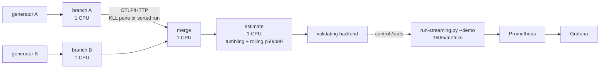
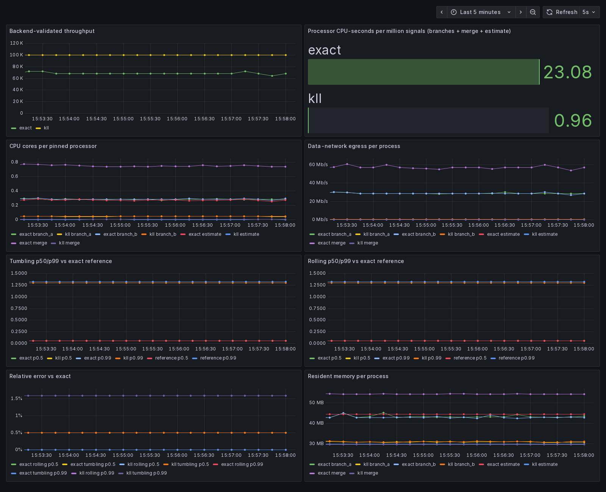
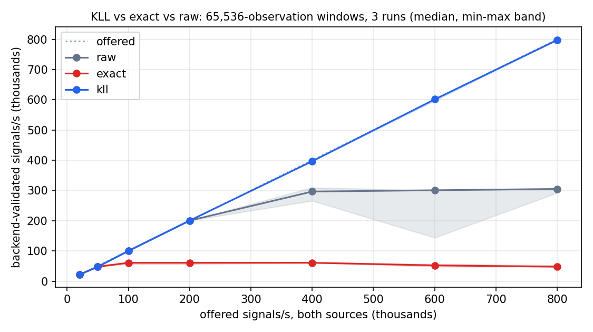

# Continuous KLL quantiles: multi-process streaming demo

The demo runs the exact and KLL pipelines side by side on the same traffic.
Every processor is its own OS process in its own container, pinned to one
CPU, and every hop is standard OTLP/HTTP over TCP. It is the
[sustained streaming benchmark](../benchmarks/STREAMING.md) topology, kept
running at one offered rate until Ctrl+C, with live metrics in Grafana.



Each branch builds one KLL sketch (`k=400`) per count-aligned window and
sends it as an ASAPv1 envelope; merge combines the two sources and estimate
answers p50/p99. Exact sends every sorted value instead. With
`--rolling-windows N`, estimate also merges the last N window sketches (exact
re-sorts the last N windows' values) for rolling p50/p99. The backend checks
every answer against the exact quantiles of the replayed corpus: exact must
match, KLL must be within 5%.

## Run the demo

Linux with Docker and Docker Compose. From the repository root:

```sh
demos/kll-grafana/run-demo.sh                      # Ctrl+C stops it
demos/kll-grafana/run-demo.sh --demo-rate 100000   # signals/s per source
```

The script builds `asap-stream-bench`, the benchmark image, and the
Prometheus/Grafana stack, then runs both pipelines with 65,536-observation
windows, six-window rolling results, and two generator CPUs per source. Each
pipeline needs 2 + 4 + 1 CPUs. Extra arguments go to
`benchmarks/run-streaming.py`. Open
<http://localhost:3000/d/asap-kll-stream>.

The dashboard shows, per scenario:

- backend-validated throughput, and processor CPU-seconds per million signals
  (branches + merge + estimate);
- CPU cores, data-network egress and resident memory of each pinned process;
- tumbling and rolling p50/p99 against the exact reference, and their
  relative error.

Rates are averaged over the last 30 seconds; windows complete in bursts. Every
window replays the same deterministic corpus, so the quantile lines are flat
by design: the moving signals are throughput and resource use.



The screenshot is from a 56-core x86 server at 50,000
signals/s per source. KLL keeps up with the offered 100,000 signals/s using
0.96 processor CPU-seconds per million signals. Exact uses 23 and is
back-pressured to about 68,000 signals/s although no exact process exceeds
0.8 CPU cores, consistent with every value crossing merge in 1,024-value
requests with one request in flight per hop. See
[benchmark results](#benchmark-results).

## Benchmark results

`benchmarks/run-streaming.py --scenarios raw exact kll --window-points 65536
--repetitions 3` on a 56-core x86 server (Ubuntu 22.04), four generator
CPUs per source, one dedicated CPU per processor. Median backend-validated
signals/s over three runs (both sources combined):

| Offered | Raw | Exact | KLL |
| ---: | ---: | ---: | ---: |
| 20,000 | 21,825 | 21,797 | 21,800 |
| 50,000 | 48,025 | 47,962 | 47,992 |
| 100,000 | 100,281 | 61,038 | 100,249 |
| 200,000 | 200,542 | 61,033 | 200,486 |
| 400,000 | 296,472 | 61,042 | 396,609 |
| 600,000 | 300,830 | 52,322 | 601,453 |
| 800,000 | 305,168 | 47,961 | 797,614 |

(At 20,000 offered, a run's 30-second interval rounds to whole windows.)



Exact plateaus near 61,000 signals/s; KLL follows the offered load to the
highest rate tested, and raw forwarding saturates near 300,000. By the
[capacity criteria](../benchmarks/CAPACITY_DESIGN.md) (delivery, backlog and
p99 window latency), the largest sustainable offered rate per source is 10,000
for exact, 100,000 for raw and at least 400,000 for KLL. Exact already
misses the latency bound at 25,000 per source (p99 6.0 s).

Summed over branch A, branch B, merge and estimate, at the same offered load:

| Offered per source | Exact CPU cores | KLL CPU cores | Exact egress | KLL egress |
| ---: | ---: | ---: | ---: | ---: |
| 10,000 | 0.63 | 0.031 | 36.7 Mbit/s | 0.1 Mbit/s |
| 25,000 | 1.41 | 0.063 | 84.4 Mbit/s | 0.2 Mbit/s |
| 50,000 | 1.69 (back-pressured) | 0.117 | 101.6 Mbit/s | 0.4 Mbit/s |

KLL answers stayed within the backend's 5% tolerance in every window
(p50 0.5%, p99 1.6% relative error); exact answers matched exactly.

The Compose stack uses host networking so Prometheus, Grafana and the metrics
endpoint listen only on `127.0.0.1` (ports 9090, 3000 and 9465;
`PROMETHEUS_PORT` and `GRAFANA_PORT` change the first two).

## Configure an OTAP rolling estimator

This processor consumes scalar observations directly, or a stream of complete
ASAPv1 KLL panes of `window_slide` width:

```yaml
type: urn:asap:processor:asap_sketches
config:
  sketch_type: kll
  window_size: 300s
  window_slide: 5s
  output_metric_name: request.duration.rolling_estimate
  agg_id: 7
  sketch_params: { k: 400 }
  transmit_sketch: false
  quantiles: [0.5, 0.99]
```

An upstream pane creator uses `window_size: 5s`, `window_slide: 5s`, and
`transmit_sketch: true`. Equal size and slide produce disjoint tumbling panes
that can be merged downstream. Overlapping sliding windows only emit scalar
estimates, preventing their overlapping sketches from being counted twice.
Omitting `window_slide` retains the original tumbling runtime behavior.

Pane boundaries align to Unix time and are half-open `[start, end)`. The
lookback must be an integer multiple of the pane width, and both durations
must be whole milliseconds. Sliding is currently KLL-only, with no late
scalar updates to closed panes.
The first results use the observations available during warmup; a complete
lookback becomes available after the process has run for that duration.

For upstream sketch input, the estimator waits for a complete pane rather than
letting a wall-clock timer race ahead of delivery. An upstream producer must
provide each complete pane once. If several producers contribute to a pane,
merge their contributions before publishing that complete pane to the sliding
processor; this change does not introduce a distributed completeness barrier
or duplicate-delivery detection. A delayed pane within retained history can be
merged, but a previously emitted range is not retroactively republished.

## Query retained tumbling panes in Rust

The host-neutral `KllWindowStore` supports raw observations and merging full
upstream panes, plus reusable aligned range queries:

```rust
use std::time::Duration;
use asap_precompute_rs::{PrecomputeConfig, SketchType};
use asap_precompute_rs::kll_windows::KllWindowStore;

let config = PrecomputeConfig {
    sketch_type: SketchType::KLLSketch,
    quantiles: vec![0.5, 0.99],
    ..Default::default()
};
let mut panes = KllWindowStore::new(
    config, Duration::from_secs(5), Duration::from_secs(300),
)?;
// panes.observe(&observation)?;
// panes.merge_pane(&upstream_full_pane)?;
panes.advance(300_000);
let merged_sketches = panes.query(0, 300_000)?;
let quantile_gauges = panes.quantile_over_time(0, 300_000, &[0.5, 0.95, 0.99])?;
```

`query` returns one full merged KLL envelope per series; `quantile_over_time`
merges first and estimates the requested quantiles, which may vary per query.
Neither query consumes stored panes. Bounds must align to pane boundaries and
exclude open or expired panes. Unaligned ranges are rejected: a compacted
sketch cannot split a partially overlapping pane into exact observations.
Quantile accuracy remains approximate according to KLL's rank error, even
when temporal selection is exact at pane boundaries.

The store retains at most `retention / pane_width` completed panes plus the
active pane. Idle `advance` calls expire old state, and a configured
`max_series` cap applies across retained panes (new series are rejected at the
cap). Retained state is in memory; restarts discard it. The ASAPv1 KLL wrapper
retains compacted items without a raw-observation replay history.

This differs from applying PromQL `quantile_over_time` to an exported p99
series: that would compute a quantile of earlier p99 estimates. Here the KLLs
are merged with their compaction weights, so the result estimates the quantile
of all original observations in the selected panes.

## Verification

With the image built and the Compose stack up (`run-demo.sh` does both):

```sh
python3 demos/kll-grafana/verify-streaming.py
```

This runs both pipelines for 60 seconds and checks per-process throughput and
CPU series for all four processors, tumbling and rolling results within
tolerance (exact: zero error), and that Grafana's datasource and the
provisioned dashboard return the same series. Pass `--docker-command
'sudo -n docker'` when Docker needs sudo.

The runtime tests exercise aligned range merging, compacted unequal-size pane
weights, series identity, expiration, idle gaps, late data, invalid ranges,
upstream completion timing, and configuration changes:

```sh
cargo test --manifest-path asap-precompute-rs/Cargo.toml --test kll_windows
```

The benchmark model tests cover rolling estimates over retained windows:

```sh
cargo test --manifest-path asap-precompute-rs/Cargo.toml \
  --features stream-benchmark --bin asap-stream-bench
```
