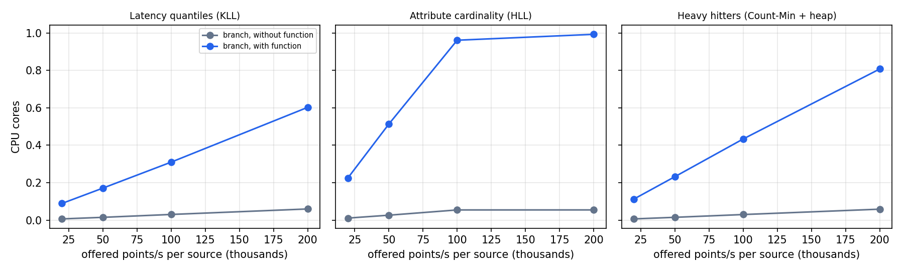

# Telemetry-function experiments

Two identical 56-core x86 servers (Ubuntu 22.04), one for inline cost and one for the exact baseline and accuracy, 2026-10-12. Every stage is an `asap-collector` container pinned to its own CPU (deploy/telemetry-functions), with 10-second windows (`experiments.py`); each point is one 60-second measurement after a 40-second warm-up.

## Findings

- **Inline cost per point** (extra branch CPU over plain forwarding, which costs about 0.3 µs): KLL 2.7–4.1 µs, Count-Min + heap 3.7–5.3 µs, HLL over four attribute keys 9–11 µs (about 2.3 µs per key). At 200,000 points/s per branch that is 0.60 cores for KLL and 0.81 for Count-Min + heap; the four-key HLL branch reaches one core at about 100,000 points/s (0.96 cores at 100,000). At 200,000 points/s per source the cardinality generator itself tops out at about 130,000 points/s, which is why that use case's *without* line flattens. These rates are below the ~1M points/s per core reference, so the next step is a profile of the per-point path (decoding OTAP into observations and the per-attribute split are the likely costs; not yet measured).
- **The global stages cost almost nothing.** Merge and detector receive a few KB to 180 KB per 10-second window and use well under 0.01 cores. The exact baseline, which receives every raw point, needs one core at about 95,000 points/s for cardinality (it holds every distinct value) and at about 400,000 points/s for latency quantiles.
- **Answers arrive 2–3 s after each window ends** (these runs used a 2-second merge grace; deployments use 5 s).
- **Accuracy follows sketch size.** KLL p99 error drops from 13% (k = 50) to 2% (k = 400) for routes with at least 20,000 points per window, while merged bytes grow from 39 KB to 181 KB per window. Count-Min + heap over 100,000 keys keeps recall@10 at 1.0 at every width; the mean count error of the top 10 falls from 6.0% (256 columns) to 0.46% (2,048 columns). Each setting is one window, so neighbouring settings can cross (k = 100 vs 200).
- **Not covered yet:** sampling plus sketches, the Arrow-native layout, and multi-machine runs.

## Inline cost

Each branch receives one source. *Without* forwards raw points only; *with* adds the fanout and the sketch. CPU is the branch pipeline's own CPU time (average of the two branches). The exact stage only counts points here, so it never slows the branches; *added per point* divides the extra branch CPU by the points each branch delivered.

### Latency quantiles (KLL)

| Offered per source | Delivered per branch | Branch CPU without | Branch CPU with | Added per point | Branch memory with | Sketch answer delay |
| ---: | ---: | ---: | ---: | ---: | ---: | ---: |
| 20,000 | 20,000 | 0.007 cores | 0.089 cores | 4.1 µs | 37 MiB | 2.1 s |
| 50,000 | 49,846 | 0.015 cores | 0.171 cores | 3.1 µs | 39 MiB | 2.9 s |
| 100,000 | 100,000 | 0.030 cores | 0.310 cores | 2.8 µs | 38 MiB | 2.2 s |
| 200,000 | 200,000 | 0.060 cores | 0.603 cores | 2.7 µs | 50 MiB | 2.7 s |

### Attribute cardinality (HLL)

| Offered per source | Delivered per branch | Branch CPU without | Branch CPU with | Added per point | Branch memory with | Sketch answer delay |
| ---: | ---: | ---: | ---: | ---: | ---: | ---: |
| 20,000 | 20,000 | 0.011 cores | 0.225 cores | 10.7 µs | 42 MiB | 2.2 s |
| 50,000 | 50,000 | 0.026 cores | 0.513 cores | 9.7 µs | 42 MiB | 2.6 s |
| 100,000 | 99,990 | 0.054 cores | 0.961 cores | 9.1 µs | 73 MiB | 2.7 s |
| 200,000 | 102,989 | 0.055 cores | 0.993 cores | 9.1 µs | 73 MiB | 2.1 s |

### Heavy hitters (Count-Min + heap)

| Offered per source | Delivered per branch | Branch CPU without | Branch CPU with | Added per point | Branch memory with | Sketch answer delay |
| ---: | ---: | ---: | ---: | ---: | ---: | ---: |
| 20,000 | 20,000 | 0.007 cores | 0.113 cores | 5.3 µs | 38 MiB | 2.9 s |
| 50,000 | 49,980 | 0.015 cores | 0.232 cores | 4.3 µs | 38 MiB | 2.3 s |
| 100,000 | 100,000 | 0.030 cores | 0.434 cores | 4.0 µs | 38 MiB | 2.8 s |
| 200,000 | 200,000 | 0.059 cores | 0.808 cores | 3.7 µs | 51 MiB | 2.6 s |

## Exact baseline cost

The alternative to inline sketches: ship every raw point to one place and compute exact answers. Here the exact stage (one pinned CPU) holds each window's raw values or distinct values; when it saturates, fanout back-pressure lowers the delivered rate. Delivered rates are approximate (5-6 ten-second windows per measurement).

| Use case | Offered (both sources) | Exact stage CPU | Points delivered |
| --- | ---: | ---: | ---: |
| Latency quantiles (KLL) | 40,000/s | 0.20 cores | 33,333/s |
| Latency quantiles (KLL) | 100,000/s | 0.46 cores | 100,000/s |
| Latency quantiles (KLL) | 200,000/s | 0.78 cores | 200,000/s |
| Latency quantiles (KLL) | 400,000/s | 1.00 cores | 392,697/s |
| Attribute cardinality (HLL) | 40,000/s | 0.49 cores | 40,000/s |
| Attribute cardinality (HLL) | 100,000/s | 0.92 cores | 83,333/s |
| Attribute cardinality (HLL) | 200,000/s | 0.97 cores | 94,636/s |
| Attribute cardinality (HLL) | 400,000/s | 0.97 cores | 93,606/s |
| Heavy hitters (Count-Min + heap) | 40,000/s | 0.17 cores | 33,333/s |
| Heavy hitters (Count-Min + heap) | 100,000/s | 0.37 cores | 83,333/s |
| Heavy hitters (Count-Min + heap) | 200,000/s | 0.71 cores | 166,667/s |
| Heavy hitters (Count-Min + heap) | 400,000/s | 0.90 cores | 333,316/s |

## Accuracy versus sketch size

One window per setting, at 20,000 points/s per source. KLL: the latency scenario (20 routes). Count-Min + heap: 100,000 Zipf routes so collisions matter. Merge bytes per window is what the merge stage receives from both branches.

| Setting | p99 error, median / max (routes >= 20,000 points) | Recall@10 | Mean count error, top 10 | Merge bytes per window |
| --- | ---: | ---: | ---: | ---: |
| cms_columns=256 |  | 1.00 | 5.99% | 7,076 B |
| cms_columns=512 |  | 1.00 | 2.82% | 11,018 B |
| cms_columns=1024 |  | 1.00 | 1.25% | 11,659 B |
| cms_columns=2048 |  | 1.00 | 0.46% | 18,537 B |
| kll_k=50 | 13.30% / 27.86% |  |  | 39,081 B |
| kll_k=100 | 6.97% / 30.29% |  |  | 58,343 B |
| kll_k=200 | 7.54% / 14.75% |  |  | 96,151 B |
| kll_k=400 | 2.03% / 6.45% |  |  | 181,083 B |
