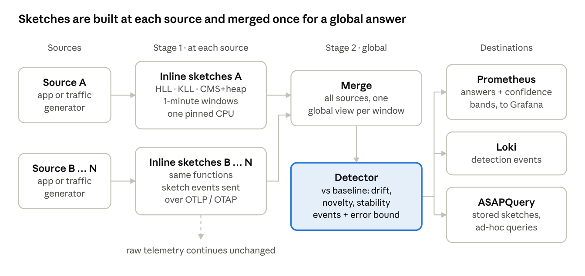
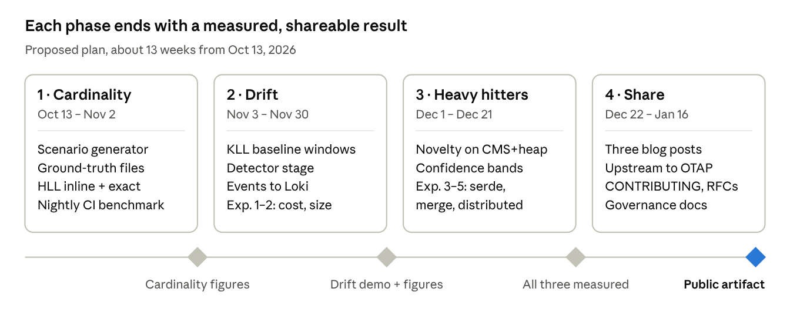

# RFC 0001: Sketch-based telemetry functions in the OTAP collector: design

| Field | Value |
| --- | --- |
| Status | Accepted |
| Date | 2026-10-12, updated 2026-10-19 after review |
| Owner | ProjectASAP maintainers |

Lines marked "Update after approval" record facts that changed after the design was accepted. Struck-through text is the original wording they replace. The section [Review feedback, 2026-10-19](#review-feedback-2026-10-19) adds the plan changes from the first demo review.

## Context and goals

We will build three sketch-based telemetry functions inside the OTAP collector, one per category in the proposal, and show their cost and accuracy with measured figures. The first audience is a technical webinar (engineers and technical managers); the second is the OpenTelemetry community.

What exists today (ASAPCollector-public):

- A multi-process demo and benchmark harness: branch A/B, merge and estimate run as separate processes, each pinned to one CPU, connected by OTLP/HTTP over TCP, with Prometheus and Grafana (PR #20).
- KLL quantiles vs exact: exact sustains 10,000 signals/s per source; KLL at least 400,000 (the highest tested), at 0.031 vs 0.63 CPU cores for the four processors at 10,000/s per source (PR #20).
- CMS + heap top-k vs exact: exact sustains 50,000/s per source; CMS + heap at least 400,000, with recall@10 = 1.0 and 0.62% count error (PR #22).

Goals for about three months:

1. A working prototype of one function per category, each driven by a concrete use case with known ground truth.
2. Measured cost of adding each function inline: throughput per CPU core, memory, added CPU and added end-to-end latency.
3. Measured accuracy against exact answers, shown to users with confidence bounds.
4. An artifact others can run: open-source code, nightly benchmarks in CI, and a blog post per use case.

Non-goals for this milestone: sampling plus sketches, and sketches as an input for agents. Both follow once the pipeline cost is understood.

## Use cases

We pick one use case per category, in priority order: cardinality and drift first (the proposal's two named categories), heavy hitters third as a full use case, since PR #22 already provides its sketch and benchmark. Each one is written backwards from the blog post it should produce.

| Priority | Category | Use case | Question the user asks | Sketch per 1-minute window | Event emitted | Ground truth in synthetic data |
| --- | --- | --- | --- | --- | --- | --- |
| 1 | Cardinality and uniqueness | Attribute stability and identifier detection | Which attribute keys explode in cardinality or behave like unique IDs (possible privacy risk)? | HLL per (metric, attribute key), plus a count | Per attribute: distinct estimate, distinct/total ratio, trend vs baseline, a stable / growing / identifier-like label | Generator sets distinct counts per attribute, including one ID-like and one exploding attribute |
| 2 | Distribution drift | Latency regression vs baseline | Did p50/p99, or the whole distribution, of a metric shift against the last hour? | KLL per (service, route) | Per series: current vs baseline quantiles, a distance (max CDF gap), drift yes/no with a bound | Generator changes one route's distribution at a known time; the telemetry shape stays the same |
| 3 | Heavy hitters and novelty | Noisy routes and new error signatures | Which keys dominate now, and which are new compared with the baseline? | CMS + heap (top-k) per attribute | Top-k with counts and error bound; keys new to the top-k vs baseline | Generator injects a new heavy key at a known time |

Common to all three:

- **Two stages.** Sketches are built inline at each source (stage 1) and merged for a global view (stage 2). The global answer is what the detector uses.
- **Readable output.** A sketch alone is not useful to a user. Each event carries the answer in plain fields (keys, counts, quantiles, labels) next to the sketch bytes, plus the error bound from the sketch configuration.
- **Measured against exact.** Each use case also runs an exact pipeline on the same traffic, as PRs #20 and #22 do, so accuracy and cost are compared directly.

## Architecture

Each function runs in two stages: an inline sketch at every source, and one merge plus detector for the global view. This is the topology PRs #20 and #22 already run, with a detector added after the merge.

- **Stage 1, inline.** A processor in each source's collector updates one sketch per (metric, attribute) per 1-minute window and emits it as an event. The raw telemetry continues unchanged, so the function can be turned off with no other effect.
- **Stage 2, global.** Merge combines the sources' sketches for a window. The detector compares the merged window with a baseline (the merge of the previous N windows) and emits drift, novelty or stability events.
- **Outputs.** Answers become Prometheus metrics with confidence bands (Grafana can draw the band from the configured error bound). Detection events go to Loki as OTLP logs. Sketches can also be stored in ASAPQuery for later queries. Merging can instead happen in ASAPQuery when that is cheaper.
- **Transport.** Sketches travel as ASAPv1 envelopes inside OTLP summaries today. Between OTAP processes an Arrow-native layout could avoid the decode; experiment 3 measures whether that matters.
- **Deployment.** ~~Each stage runs in its own container, pinned to its own CPU, and later on separate machines connected over the network.~~ *Update after approval:* every pipeline stage runs as the official OTAP engine (`asap-collector`, the upstream controller with the ASAP nodes linked in) in its own pinned container; multi-machine runs come later when machines are available.

## Workload and ground truth

We start with synthetic data whose answers are known, generated by an extended OTAP traffic generator; traffic with realistic distribution properties follows later.

*Update after approval:* the official OpenTelemetry traffic generator cannot yet shape attribute cardinality, popularity or value distributions, or change them over time; that is planned upstream, and until then a temporary local receiver, `urn:asap:receiver:scenario_generator`, in this repository stands in.

The current benchmark replays one fixed corpus per window: durations for KLL, Zipf(1.1) keys over 2^20 ranks for top-k. That is enough for throughput, but every window looks the same, so nothing drifts. The extension adds scenario knobs to the generator:

| Knob | Drives | Example setting |
| --- | --- | --- |
| Distinct values per attribute key | Cardinality | `route`: 200, `user.id`: unique per event, `pod`: grows 5% per minute |
| Value distribution per series | Drift | `checkout` latency lognormal, its median doubling at minute 30 |
| Key popularity | Heavy hitters, novelty | Zipf(s) over N keys, plus a new key reaching the top 10 at minute 45 |
| Change schedule | All | When each change starts and how fast it ramps |
| Rate and number of sources | Cost | Signals/s per source, 2 to N sources |

The telemetry shape (metric names, attribute keys, resource attributes) stays fixed while values change, which matches the proposal's drift case. ~~The generator writes the ground truth (exact distinct counts, quantiles and top-k per window) to a side file, so every figure can be scored without a second exact pipeline.~~ *Update after approval:* instead of a generator side file, three pipelines run side by side and share no processor: the sketch pipeline; an exact pipeline (exact window per source, exact merge, exact detector), whose answers are the ground truth; and a raw pipeline that forwards every point to a log store. Each has its own generators with the same config and scenario start, and the generated points depend only on scenario time, so all three get identical input. Every pipeline reports its window completion delay. *Update after review:* the raw pipeline becomes the "store everything, query later" baseline: one receiver writes to the log store, and the answer comes from a periodic query against it (see [Review feedback](#review-feedback-2026-10-19)).

Split of work: we extend the generator and the scoring; our collaborators supply the scenario definitions (which attributes, which shifts) and, later, traffic with real distribution properties.

## Evaluation and success metrics

The key question is whether inline measurement is cheap enough to leave on. We answer it by comparing the same pipeline with and without each function, on the same machine and traffic.

| Metric | How it is measured | What counts as success |
| --- | --- | --- |
| Ingestion throughput per CPU core | Highest sustained signals/s at the capacity criteria (delivery, backlog, p99 window latency), per pinned core | Close to the \~1M points/s per core reference from the OTAP benchmark framework, with and without the function |
| Added CPU | Process CPU of each stage, with minus without the function, at the same offered load | A small, stated fraction of the base pipeline |
| Memory | Sampled and peak RSS per process | Bounded and independent of cardinality |
| Accuracy | Error against ground truth per window: relative distinct-count error, quantile or CDF error, recall@k and count error | Within the configured error bound, shown as a confidence band |
| End-to-end latency | Window close to answer at the backend, with and without the detector stage | Added latency well under one window |
| Egress | Bytes on the wire per stage | Sketch egress orders of magnitude below raw or exact |

Experiments, in order:

1. **Inline cost.** Pass-through vs pass-through plus sketch creation, per function, swept over rate and sources. Output: an enable or disable rule per function.
2. **Accuracy vs size.** Sweep sketch parameters (HLL precision, KLL k, CMS width and heap size) and plot error against memory and bytes.
3. **Serialization.** Split sketch encode and decode from update and merge using the existing CPU-scope profiler. Compare ASAPv1 MessagePack with an Arrow-native layout, where OTAP could avoid a decode.
4. **Merge at scale.** Merge 10, 100 and 1,000 sketches per window and time it. 1,000-way merges were flagged as possibly slow.
5. **Distributed run.** Stages on separate machines over the network, ending in Prometheus, to check the single-host numbers.
6. **Later: sampling plus sketches.** Only after experiments 1 to 4 show where the cost goes.

*Update after review:* experiments 7 to 9 in [Review feedback](#review-feedback-2026-10-19) add whole-system cost, freshness against the store-and-query baseline, and a traffic-scaling sweep.

## Review feedback, 2026-10-19

*Update after approval.* The first review of the three-pipeline demo asked for one main change: show the trade-off, not only the sketch's cost. Computing in front of the database stores much less and drops the raw data. The alternative is storing every point and querying later. Each side pays something, and the blog has to show what. This section records the feedback as decisions, and the work each one adds.

### What the blog has to answer

How can the answer be computed most efficiently, and which approach wins on each axis? Three approaches answer the same question on identical input:

| Approach | Computes | Stores | Answer arrives |
| --- | --- | --- | --- |
| Sketch | Inline sketches, one merge, a detector | Answers and sketches only | After the window closes plus the completion delay |
| Exact | Exact window per source, exact merge, the same detector | Answers only | Same as sketch; the merge carries every key |
| Store and query | Nothing inline | Every raw point in the log store | When the periodic query returns |

The axes are CPU, memory, bytes on the wire, throughput, freshness and accuracy. The blog states the winner on each axis with a measured number, for example "the sketch pipeline uses X fewer cores and Y fewer bytes than exact, and answers Z seconds sooner than store and query".

### Definitions

- **Metric data points, not "signals".** All three use cases read OTLP metric data points. Earlier text says "signals/s"; it means metric data points per second, and new text says "points/s".
- **Freshness.** Seconds from the end of a window (the time of its last generated point) until its answer can be queried. For sketch and exact this is the window completion delay already on every dashboard. Every summary answer is at least one window (1 minute) old when it appears; the delay is on top of that.
- **Freshness of store and query.** Time until the log store acknowledges the window's last point, plus the latency of the query that computes the answer. Both are measured, so the log store's query latency is shown next to the sketch's completion delay.
- **End-to-end detection latency.** Seconds from the injected change (for example `/new/hot-route` starting) until the detection event is in Loki, per approach.

### Changes to the baselines and metrics

1. **Store and query has one stage.** The raw pipeline has one receiver per source that writes to the log store, with no branch or merge forwarding stages. A query job runs the use case's query against the store once per window, for example top-k routes by count over the last minute, and reports its answer, its query latency and its accuracy against exact.
2. **Whole-system cost.** CPU and memory per approach include everything needed to get the answer: the pipeline stages, the log store, and the query job for store and query, and the answer backend for sketch and exact. Cost is shown together with freshness, so the trade-off is visible on one panel.
3. **Bytes per stage.** Bytes on the wire are broken down per hop (source to merge, merge to detector, detector to backend), not only per pipeline. The pipelines differ by orders of magnitude, so the panels use a log scale and say so.
4. **Traffic that grows over time.** The scenario adds a rate ramp, so the dashboards show how each pipeline's bytes, CPU and memory grow with input. Sketch cost should stay nearly flat; exact and store-and-query grow with keys and points.
5. **Exact merge made visible.** Exact merge has to combine every key's count before it can pick the top-N. Its CPU, memory and bytes get their own panel, since that stage is where the exact approach stops scaling.

### New experiments

7. **Whole-system cost per approach.** At a fixed rate, CPU and memory of every container each approach needs, including the log store and the query job.
8. **Freshness against store and query.** Window completion delay for sketch and exact against ingest plus query latency for store and query, per rate.
9. **Traffic scaling.** Input from 10,000 to 50,000 points/s per source and beyond, on one node and then on several. Per stage CPU, memory and bytes, to show which stage limits each approach. Where a test only needs the pipeline to keep up, sampling the input keeps the generators from backpressure; the sampled rate is stated next to every figure.

### Benchmark playground

A Kubernetes-deployed playground where readers pick the dimensions themselves: use case, approach, input rate, number of sources and sketch size. It shows the same panels as the demo, and readers can comment in the playground when they spot an error or want another view. The [OTel Arrow comparison page](https://open-telemetry.github.io/otel-arrow/compare/) is the model for the comparison view. The setup (cluster, data retention, who can comment) is still open.

### Questions from the review, answered

- **Metrics or signals?** Metric data points. See Definitions.
- **How are sketches transmitted? Over the OTel Arrow protocol, in a self-describing format?** Inside a collector, records are OTAP Arrow batches. A sketch is an OTLP Summary data point whose `sketch.envelope` attribute holds ASAPv1 bytes. ASAPv1 is self-describing: the bytes carry the sketch kind and version, and the window bounds, labels and metric name travel as OTLP fields next to them. Between collectors the stages use the OTLP/HTTP exporter today, not the OTel Arrow gRPC protocol. Experiment 3 measures what an Arrow-native layout and protocol would save.
- **Are the public repository's PRs reviewed?** Not yet. The stack is open for review, starting from the oldest PR.

### Open questions from the review

- [ ] Which few figures make the blog's point best? Candidates: cost against freshness per approach; bytes per stage on a log scale; cost as traffic grows.
- [ ] Which query does store and query run per use case, and how often? Once per window matches the summaries; more often trades store CPU for freshness.
- [ ] Where does the playground run, and who can comment in it?
- [ ] Is sampling acceptable in published figures, or only in tests that need the pipeline to keep up?

## Open source, adoption and governance

Adoption depends on a team being able to switch a function on, see its cost, and trust its answers. Continuous benchmarks give the evidence; a clear contribution process makes it safe for more people to work on the code.

**What would give an operator the confidence to deploy:**

- A published cost per function (CPU per core, memory, added latency) at their traffic rate, with an off switch.
- Accuracy stated as a bound and shown next to every answer, not hidden in a paper.
- No regression across releases, proven by benchmarks in CI.
- Components upstream in, or compatible with, OTAP, so the deployment does not depend on a fork.

**Benchmarks in CI** (OpenTelemetry practice):

| Tier | When | Scope | Gate |
| --- | --- | --- | --- |
| Continuous | Every merge to main | Short smoke run of each scenario, correctness checks | Fails on wrong answers |
| Nightly | Every day | Full rate sweep per scenario (the PR #19/#20/#22 harness) | Alerts on a throughput or CPU regression beyond a set margin |
| On demand | Comment on a PR | Same sweep, this PR vs main | Posts a comparison table |

**Process for many contributors** (following OpenTelemetry):

- Roles: contributors (anyone), approvers (review), maintainers (merge and release); a written bar for becoming a maintainer.
- A CONTRIBUTING guide: PR expectations, templates, how review works, and the design principles. It is written for both people and AI agents.
- Long designs go in an RFC doc in the repository; everything else in GitHub issues with bug, feature and capability templates.
- A weekly sync meeting; at most two open PRs per contributor.
- Design principles and success metrics fixed early, for example that performance matters, so the end-to-end benchmark is part of every change.

## Milestones

We ship one measured use case per phase, so each phase can end in a blog post and a demo. The dates are a proposal to agree with our collaborators.

Each gate means: the function runs inline and in the exact baseline, the nightly benchmark covers it, and the figures from the evaluation section exist for it. The webinar date still needs to go on this plan; whichever phase it falls in, the demo uses the latest completed gate.

## Open questions

For our collaborators:

- [ ] Which attributes and shifts should the first synthetic scenarios use, and when can traffic with real distribution properties be provided?
- [ ] Is a 1-minute window right for the events, or do detectors need shorter panes merged into longer windows?
- [ ] Where should answers land first: Prometheus metrics, Loki (OTLP logs) events, or ASAPQuery?
- [ ] Which parts belong in the open-source project, and which stay internal?
- [ ] What added CPU or latency would make a function "always on" rather than opt-in?

For us:

- [ ] Drift distance: max CDF gap (Kolmogorov–Smirnov style) from KLL, or quantile shifts at fixed points? The bound is easier to state for the first.
- [ ] Arrow-native sketch layout: worth prototyping before experiment 3, or after its numbers?
- [ ] Upstream path to OTAP: which pieces (processor, sketch carrier, generator knobs) to propose first, and through which OpenTelemetry SIG.

Next, after this milestone: sketches as the input for agents, so an agent sees summaries instead of raw telemetry (smaller and more private). Planned for next month.
