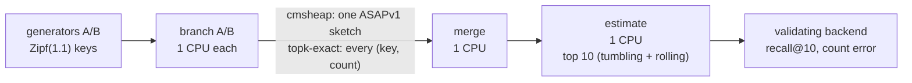
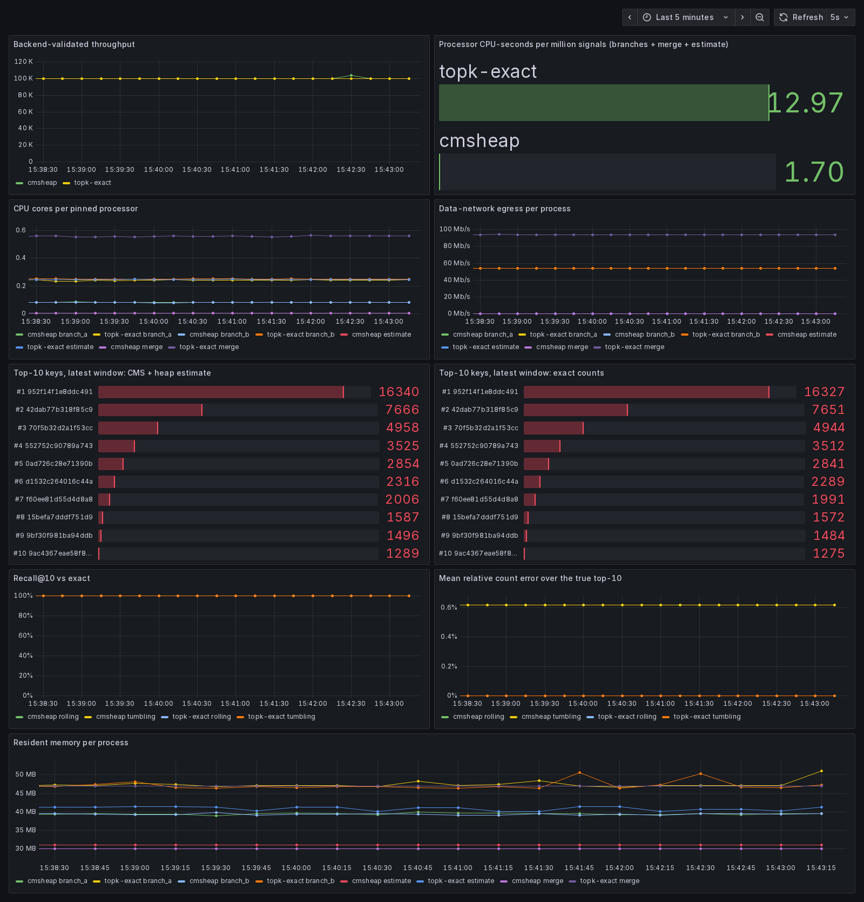

# Top-k heavy hitters: Count-Min sketch with heap vs exact counting

The top-k demo runs the same multi-process topology as the
[KLL demo](./kll-windows.md): every processor is its own OS process in its own
container, pinned to one CPU, and every hop is OTLP/HTTP over TCP. Two
pipelines run side by side on identical keyed traffic:



- **`cmsheap`**: each branch inserts every key into a
  [`CMSHeapWrapper`](../asap-precompute-rs/src/sketches/cms_heap.rs), which
  wraps `asap_sketchlib::CMSHeap`: a 4 x 2048 Count-Min sketch plus a 10-slot
  heavy-hitter heap. One ASAPv1 envelope (`CountMinSketchWithHeap`, kind
  `0x03 0x00`) per source and window goes to merge. Merge adds the counters
  and re-ranks both heaps' candidates on the merged counters; estimate reads
  the top 10 from the heap.
- **`topk-exact`**: each branch counts keys in a hash map and ships every
  (key, count) entry; merge sums the maps; estimate sorts them for the top 10.

Keys are 64-bit values drawn from Zipf(s=1.1) over 2^20 ranks, deterministic
per corpus index, with disjoint index ranges per source. A 65,536-key window
has about 17,000 distinct keys per source and 30,000 after merging both. Every window replays the same
corpus, so the backend compares each answer with the exact top 10 computed
once at startup: `topk-exact` must match exactly, and `cmsheap` must reach
recall@10 of at least 0.9 in every window, or the run fails. With
`--rolling-windows N`, estimate also answers over the last N windows by
merging sketches or summing maps.

## Run

Linux with Docker and Docker Compose. From the repository root:

```sh
demos/kll-grafana/run-demo.sh --scenarios topk-exact cmsheap   # Ctrl+C stops
```

Open <http://localhost:3000/d/asap-topk-stream>. The dashboard shows
backend-validated throughput, processor CPU-seconds per million signals,
per-process CPU, egress and memory, both pipelines' current top 10 with
counts, recall@10, and mean relative count error over the true top 10.



Verify the demo end to end (60 seconds):

```sh
python3 demos/kll-grafana/verify-streaming.py --scenarios topk-exact cmsheap
```

Benchmark sweep (see [STREAMING.md](../benchmarks/STREAMING.md)):

```sh
python3 benchmarks/run-streaming.py --scenarios raw topk-exact cmsheap \
  --window-points 65536 --repetitions 3
```

`summary.csv` adds `min_recall_at_k` and `median_mean_relative_count_error`
for top-k rows.
